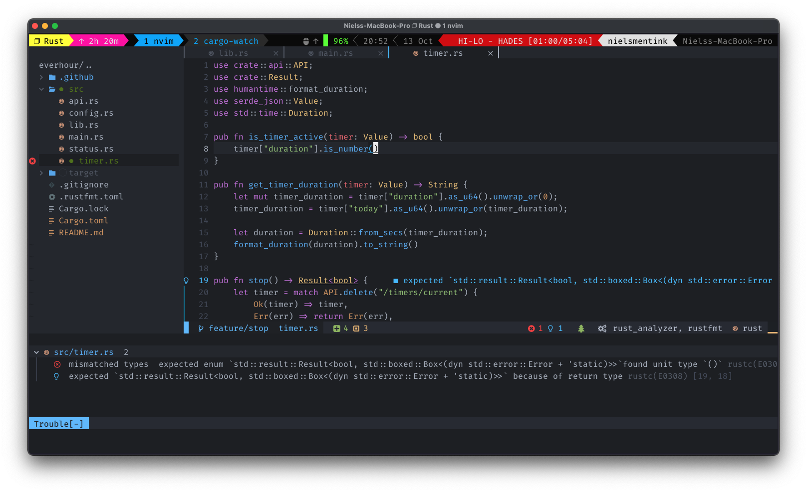

# Dotfiles ⚙️



## Requirements 📦

- Git
- macOS or another chezmoi-supported system

## Installation 🪄

Bootstrap a new machine with chezmoi:

```bash
sh -c "$(curl -fsLS https://get.chezmoi.io)" -- init --apply V1RE/dotfiles
```

Review pending changes later with:

```bash
chezmoi diff
```

Apply them with:

```bash
chezmoi apply
```

## mise profiles

Shared tools live in `dot_config/mise/config.toml`. Platform profiles
(`config.macos.toml` / `config.linux.toml`) load automatically via `auto_env`.
The default role is `desktop` when chezmoi's `hasGUI` is true, otherwise `worker`.
Workers keep additional development tools lazy; Java, EAS, Wrangler and calldiff
are lazy on both roles. Installed lazy tools are not uninstalled.

Override the role per machine in `~/.config/mise/miserc.local.toml`:

```toml
env = ["worker"] # or ["desktop"]
```

Tool installation runs after the profiles are deployed. Existing
`~/.config/mise/config.local.toml` overrides are preserved; on older Linux
installs, its generated tool entries can still override platform defaults.

## Atuin Threads and output capture

mise installs Atuin **18.24.2** (Threads requires 18.24+) on macOS and Linux,
including upgrades from older versions. Keep this pin current when updating
Atuin; a machine-local mise override can still select an older binary.

The daemon captures Claude Code, Codex, Pi, Omp and OpenCode sessions without
extra agent hooks. All five are already installed by these dotfiles. Amp is
not supported by Threads and is not connected here.

Both capture features are **off by default**, including on existing machines
without the new chezmoi data values. New `chezmoi init` runs ask separately.
To opt in later, set either or both under `[data]` in `chezmoi edit-config`
(not in the dotfiles repository):

```toml
atuinThreadsCapture = true
atuinOutputCapture = true
```

Then run `chezmoi diff`, `chezmoi apply`, and `atuin daemon restart`. Open a new
shell for pty-proxy/output capture, and restart your agents for MCP.
Check `atuin --version` reports at least
18.24, then use `atuin resume` or `atuin threads search "your query"`.
To disable capture persistently, set the data value to `false`, apply and restart
the daemon and open a new shell again. Direct `atuin config enable/disable`
changes to these features are overwritten by apply; use the chezmoi data values.

### Privacy and sync

- No login, registration, sync enablement or historical import runs during apply.
  Existing authentication, encryption keys, sync server and sync settings remain
  unchanged. No new cloud account is configured.
- **Capture uses Atuin's existing encrypted record sync.** If this machine already
  syncs shell history, captured threads will sync too. This setup does not offer
  a separate local-only switch for threads while preserving shell-history sync;
  leave capture off if that is not acceptable.
- Capture includes conversations, tool input/output and file diffs. Upstream
  redacts recognised secrets, but this is not a guarantee that sensitive code or
  text is removed. Review Atuin's filters before opting in.
- Old sessions are not bulk imported. **Resuming an old session after enabling
  capture captures the whole session**, including its earlier contents. Only run
  `atuin threads import` if you deliberately want the remaining history captured
  (and synced when sync is active); use `--harness` to limit the agent.

### MCP

After mise installation, the upstream `atuin mcp install` commands merge the
`atuin` entry into Claude Code, Codex, Pi and Omp's local user configuration,
preserving other entries. OpenCode's entry lives directly under `mcp.atuin` in
its managed config. OpenCode 2.2 normalizes this supported legacy shape to
`mcp.servers.atuin` internally; its other existing servers need no migration.
Reapplying is safe; unrelated credentials and agent settings are not replaced.
To reinstall these four registrations after
local config changes, run `atuin mcp install <agent>` individually
(`claude`, `codex`, `pi`, `omp`).

The stdio server is read-only and runs locally, but gives the connected agent
access to existing **shell history**, and any captured output and threads.
The agent's model/provider may receive retrieved content. MCP registration does
not itself enable thread or shell-output capture. Check with `claude mcp list`,
`codex mcp list`, `pi mcp list`, `opencode mcp list`, or `/mcp` in Omp.
OpenCode 2.2 initializes MCP plugins asynchronously: a first status check just
after starting a private server can be empty; check again on the same server.
OpenCode inherits `atuin` from the mise-enabled shell's PATH; for a GUI launcher
without that PATH, use the absolute path reported by `which atuin`.

### Terminal output capture

The separate output opt-in enables both `[pty_proxy]` and `[output]`; the daemon
is already enabled with autostart. The existing live `atuin init zsh` loads the
proxy integration without extra hooks. Threads and output capture can be enabled
independently and use the same daemon and MCP server.

Shell output is **local only** in Atuin 18.24.2, even when history sync is active.
This differs from tool output inside Threads, which is part of the synced thread.
No output-sync setting is changed. MCP/Atuin AI can still pass retrieved output
to a model. Secret redaction is best-effort; use `command_filter`, `history_filter`
and `cwd_filter` for sensitive workflows. A leading space excludes a shell
command and its output with Atuin's defaults. Alternate-screen programs such as
Vim/less are not recorded.

Output is limited to **1MB per command** (start and end retained if larger) and a
**1GB disk budget**, rather than upstream's default 10% of the disk. The daemon
checks periodically, deleting oldest output above 95% of budget until back at
90%, so this is not a strict instantaneous cap. Data lives in Atuin's
`output-capture` data directory. Disabling capture leaves already stored output
intact; deleting a history entry also removes its output. These limits do not
limit the Threads record store.

Try `printf 'atuin-output-check\n'` in a new shell, then
`atuin output search atuin-output-check`, or inspect a command with Ctrl-O in
history search. No historical terminal output can be recovered retroactively.

References: [Threads announcement](https://blog.atuin.sh/threads-agent-sessions/),
[Threads documentation](https://docs.atuin.sh/latest/ai/threads/),
[MCP documentation](https://docs.atuin.sh/latest/ai/mcp/),
[output capture documentation](https://docs.atuin.sh/latest/guide/output-capture/).
